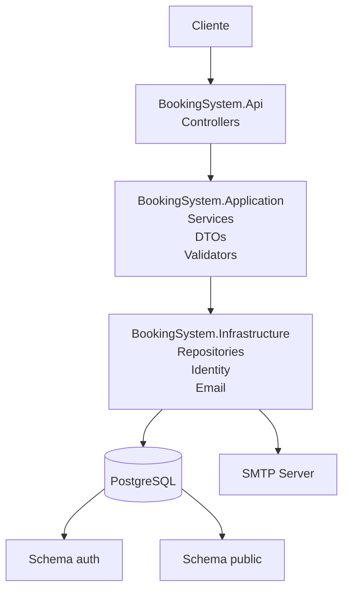

# Booking System API

API REST desarrollada en **ASP.NET Core 10** siguiendo los principios de **Clean Architecture**, orientada a la gestión de hoteles, habitaciones y reservas.

---

# Tecnologías

| Categoría | Tecnología | Propósito |
|-----------|------------|-----------|
| Framework | ASP.NET Core 10 | Desarrollo de la API REST |
| Arquitectura | Clean Architecture | Separación de responsabilidades |
| Lenguaje | C# | Desarrollo de la aplicación |
| ORM | Entity Framework Core | Acceso a datos |
| Base de datos | PostgreSQL | Persistencia |
| Autenticación | ASP.NET Identity | Gestión de usuarios |
| Seguridad | JWT Bearer Authentication | Autenticación de la API |
| Validaciones | FluentValidation | Validación de solicitudes |
| Correo | SMTP + Scriban | Envío de correos HTML |
| Documentación | Swagger / OpenAPI | Documentación interactiva |
| Control de versiones | Git + GitHub | Gestión del código fuente |

---

# Arquitectura

La solución implementa una **Clean Architecture**, separando la lógica de negocio, el acceso a datos y la infraestructura para facilitar el mantenimiento, las pruebas y la escalabilidad.

```text
BookingSystem
│
├── src
│   ├── BookingSystem.Api
│   │   ├── Configurations
│   │   ├── Controllers
│   │   ├── Extensions
│   │   ├── Filters
│   │   ├── Middlewares
│   │   ├── Properties
│   │   └── Program.cs
│   │
│   ├── BookingSystem.Application
│   │   ├── Constants
│   │   ├── DTOs
│   │   ├── Exceptions
│   │   ├── Interfaces
│   │   ├── Mapping
│   │   ├── Services
│   │   ├── Validators
│   │   └── Wrappers
│   │
│   ├── BookingSystem.Domain
│   │   ├── Common
│   │   ├── Entities
│   │   └── Enums
│   │
│   └── BookingSystem.Infrastructure
│       ├── Configurations
│       ├── Context
│       ├── Identity
│       ├── Migrations
│       ├── Repositories
│       ├── Services
│       └── Templates
│
├── docs
├── postman
└── README.md
```



La API expone los endpoints REST; la capa **Application** contiene la lógica de negocio, DTOs y validaciones; **Infrastructure** implementa el acceso a datos, autenticación y envío de correos. La base de datos se encuentra dividida en los esquemas **auth** y **public** para desacoplar la autenticación del dominio de negocio.

---

# Decisiones técnicas

Durante el desarrollo se tomaron las siguientes decisiones de diseño:

- **Clean Architecture** para separar responsabilidades y facilitar el mantenimiento, las pruebas y la evolución del sistema.
- **Repository Pattern** para desacoplar la lógica de negocio del mecanismo de persistencia.
- **Unit of Work** para coordinar operaciones que modifican múltiples entidades dentro de una misma transacción lógica.
- **ASP.NET Identity** para la autenticación y administración de usuarios, evitando implementar mecanismos de seguridad desde cero.
- **FluentValidation** para centralizar las validaciones de entrada y mantener los controladores y servicios enfocados en la lógica de negocio.
- **Scriban** para separar las plantillas HTML del código fuente y facilitar el mantenimiento de los correos electrónicos.
- **PostgreSQL** como motor de base de datos por su estabilidad, rendimiento y soporte para tipos de datos avanzados.

# Funcionalidades

## Autenticación

- Registro de usuarios
- Inicio de sesión
- JWT Bearer Authentication
- Recuperación de contraseña mediante correo electrónico
- Cambio de contraseña

## Hoteles

- Crear hotel
- Consultar hoteles
- Consultar hotel por Id
- Actualizar hotel
- Eliminación lógica (Soft Delete)
- Actualizar estado (Activo/Inactivo)

## Habitaciones

- Crear habitación
- Consultar habitaciones por hotel
- Consultar habitación por Id
- Actualizar habitación
- Eliminación lógica (Soft Delete)
- Actualizar estado (Activo/Inactivo)

## Disponibilidad

Permite consultar habitaciones disponibles filtrando por:

- Ciudad
- Fecha de ingreso
- Fecha de salida
- Número de huéspedes

Solo se retornan habitaciones que:

- Se encuentran activas.
- Pertenecen a hoteles activos.
- No tienen reservas que se crucen con el rango de fechas solicitado.

## Reservas

- Consultar todas las reservas.
- Consultar reserva por Id.
- Crear reserva.
- Actualizar estado de una reserva.

Durante la creación de una reserva el sistema valida:

- Existencia del hotel y la habitación.
- Estado del hotel.
- Estado de la habitación.
- Capacidad máxima permitida.
- Disponibilidad para el rango de fechas solicitado.

Cada reserva almacena:

- Habitación.
- Huéspedes.
- Contacto de emergencia.
- Estado.
- Costo total.

Al confirmar una reserva se envía un correo electrónico al huésped principal y se incluye al resto de huéspedes como copia (CC).

---

# Características implementadas

- Clean Architecture
- Dependency Injection
- Repository Pattern
- Unit of Work
- DTO Pattern
- Mapper Pattern
- FluentValidation
- Validaciones de negocio
- Soft Delete
- Global Exception Handling
- Filtros dinámicos
- Paginación
- Consulta de disponibilidad
- Validación de capacidad de habitaciones
- Confirmación de reservas mediante correo electrónico
- Plantillas HTML con Scriban
- Variables de entorno
- JWT Authentication
- ASP.NET Identity
- Swagger / OpenAPI

---

# Requisitos

- .NET 10 SDK
- PostgreSQL
- Visual Studio 2022 (17.14 o superior)

---

# Seguridad

La API implementa las siguientes medidas de seguridad:

- Autenticación mediante JWT Bearer.
- Hash de contraseñas mediante ASP.NET Identity.
- Validación de entradas con FluentValidation.
- Manejo centralizado de excepciones.
- Variables sensibles mediante variables de entorno.

---

# Instalación

## 1. Clonar el repositorio

```bash
git clone https://github.com/Juanfdoa/BookingSystem.git
cd BookingSystem
cd src
```

## 2. Restaurar las dependencias

```bash
dotnet restore
```

## 3. Configurar las variables de entorno

Durante el desarrollo las variables pueden configurarse desde el archivo **launchSettings.json** o mediante variables de entorno del sistema.

```json
{
  "CONNECTION_STRING": "Host=localhost;Port=5432;Database=BookingSystem;Username=postgres;Password=********",
  "JWT_SECRET": "your-secret-key",
  "JWT_ISSUER": "https://booking-system.com/",
  "JWT_AUDIENCE": "BookingSystemClient",
  "EMAIL_SMTP": "smtp.gmail.com",
  "EMAIL_PORT": "587",
  "EMAIL_USERNAME": "your-email@gmail.com",
  "EMAIL_PASSWORD": "your-app-password"
}
```

> **Nota:** Para Gmail es necesario utilizar una **App Password** en lugar de la contraseña de la cuenta.

---

## 4. Crear la base de datos

El proyecto utiliza dos esquemas independientes en PostgreSQL.

### Esquema `auth`

Contiene todas las tablas relacionadas con la autenticación y autorización mediante **ASP.NET Identity**.

Los scripts se encuentran en:

```text
BookingSystem.Infrastructure/
└── Identity/
    └── Scripts/
```

Estos scripts deben ejecutarse sobre el esquema **auth**.

### Esquema `public`

Contiene todas las tablas correspondientes al dominio de la aplicación:

- Hotels
- Rooms
- Reservations
- Guests
- EmergencyContacts

Los scripts se encuentran en:

```text
BookingSystem.Infrastructure/
└── Migrations/
```

Estos scripts deben ejecutarse sobre el esquema **public**.

> **Recomendación**
>
> Se recomienda mantener separados los esquemas **auth** y **public**, ya que esta división desacopla el módulo de autenticación del dominio de negocio. Esto facilita reemplazar ASP.NET Identity por otro proveedor de identidad (como Keycloak, Auth0 o Azure AD) con un impacto mínimo sobre la aplicación.

---

## 5. Ejecutar la aplicación

```bash
dotnet run
```

---

## 6. Acceder a Swagger

Una vez iniciada la aplicación, la documentación de la API estará disponible en:

```
https://localhost:7040/swagger
```

---

# Flujo de creación de una reserva

1. El usuario consulta habitaciones disponibles.
2. El sistema valida:
   - Disponibilidad.
   - Capacidad máxima.
   - Estado del hotel.
   - Estado de la habitación.
3. Se calcula el costo total de la reserva.
4. Se registra la reserva.
5. Se registran los huéspedes.
6. Se registra el contacto de emergencia.
7. Se envía un correo electrónico de confirmación.

---

# Patrones utilizados

- Clean Architecture
- Dependency Injection
- Repository Pattern
- Unit of Work
- DTO Pattern
- Mapper Pattern

---

# Consideraciones

- Todas las fechas se almacenan en UTC.
- Se implementa eliminación lógica mediante **Soft Delete**.
- Las consultas excluyen automáticamente los registros eliminados.
- El envío del correo electrónico no afecta la creación de la reserva en caso de fallo.
- La autenticación se encuentra desacoplada del dominio mediante el uso de esquemas independientes en la base de datos.

---

# Mejoras futuras

La implementación actual cumple con los requisitos planteados para la prueba técnica. Sin embargo, en un entorno de producción podrían considerarse las siguientes mejoras:

- **Separación del módulo de autenticación**
  - Desacoplar el sistema de autenticación y autorización en un microservicio independiente o integrar un proveedor de identidad como Keycloak, Auth0 o Azure AD, permitiendo que múltiples aplicaciones compartan el mismo servicio de autenticación.

- **Proveedor de correo electrónico especializado**
  - Reemplazar el envío mediante SMTP por un servicio especializado como SendGrid o Amazon SES, mejorando la entregabilidad, escalabilidad, monitoreo y administración de plantillas de correo.

- **Procesamiento asíncrono de correos**
  - Publicar un evento al crear una reserva y procesar el envío del correo en segundo plano mediante un sistema de mensajería (RabbitMQ), evitando que un fallo en el servicio de correo afecte el tiempo de respuesta de la API.

- **Implementación de caché**
  - Incorporar Redis para almacenar información consultada con frecuencia, como hoteles, habitaciones y disponibilidad, reduciendo la carga sobre la base de datos y mejorando el rendimiento.

- **Pruebas automatizadas**
  - Incrementar la cobertura mediante pruebas unitarias e integrales para validar la lógica de negocio y el comportamiento de la API.

- **Integración y despliegue continuo (CI/CD)**
  - Implementar un pipeline de integración y despliegue continuo utilizando GitHub Actions o Azure DevOps para automatizar compilaciones, pruebas y despliegues.

- **Monitoreo y observabilidad**
  - Incorporar herramientas de registro y monitoreo como Serilog para facilitar el diagnóstico de errores y el seguimiento del comportamiento de la aplicación.

---

# Uso de Inteligencia Artificial

Durante el desarrollo se utilizaron herramientas de inteligencia artificial como apoyo para:

- Refinar la documentación técnica.
- Generar propuestas iniciales para plantillas HTML.
- Revisar y mejorar consultas SQL.
- Asistir en la construcción de código repetitivo.
- Generar datos de prueba y completar solicitudes JSON utilizadas durante las pruebas de los endpoints.

Todo el código generado fue revisado, adaptado y validado manualmente antes de incorporarse a la solución.

---

# Colección Postman

Se incluye una colección de Postman con todos los endpoints del sistema.

Ubicación: https://github.com/Juanfdoa/BookingSystem/tree/main/postman/BookingSystem.postman_collection